# Cloud Paper Trading Agent

A Python-based, cloud-hosted paper trading prototype that combines Robinhood MCP data, an AI agent, and a deterministic risk engine. Built with AI-assisted development.

**Paper only:** the broker integration exposes seven read-only tools. This implementation cannot submit, cancel, or exercise real orders. A configuration change cannot enable live execution.

## Architecture

```mermaid
flowchart LR
    Scheduler[Market-calendar scheduler] --> Collector[Codex + read-only Robinhood MCP]
    Collector --> Adapter[Normalize and validate data]
    Adapter --> Engine[Rules and candidate generation]
    Engine --> Agent[AI accept / veto / exit decision]
    Agent --> Control[Host risk and plan validation]
    Control --> Ledger[Durable paper ledger and audit]
    Ledger --> Report[Static HTML report]
```



The host process owns scheduling and ledger updates. Each agent turn has a separate job directory, structured JSON output, a timeout, and restricted tool access. Candidate sizing and mandatory exits are computed by Python; the agent selects actions and supplies reasons.

## What is implemented

- Read-only account, portfolio, quote, historical-price, tradability, approval-setting and earnings collection through MCP.
- Completed-bar breakout filters using SMA, VWAP, ATR and volume; intraday and multi-session paper positions.
- Deterministic position sizing, exposure limits and loss-review pauses.
- Quote age, cache date and snapshot checks; missing or invalid data blocks new paper buys.
- File locks, snapshot/plan digests, atomic file replacement, and persistent scheduling slots to reduce duplicate processing.
- A durable JSON ledger, JSONL audit records and an HTML status snapshot.
- Debian/systemd installation, native OAuth login and loopback-only service binding for the GCP deployment route.
- A fixed read-only MCP allowlist, disabled additional ChatGPT apps, and sandboxed agent execution.
- 51 offline software tests covering risk, data validity, persistence, scheduling and access configuration.

## Requirements and offline checks

Use Python 3.11+ on Linux or macOS. The Python code uses the standard library, including Unix file locking; Windows has not been validated.

```sh
python3 -m unittest -v test_engine.py cloud/test_cloud.py
python3 engine.py status
```

The first command uses synthetic fixtures and mocked collection, with no broker login or cloud resources required. The second creates a local report with an unconnected demo balance; it does not collect market data or create a trade. Runtime output is ignored by Git.

For a fresh, unfunded demonstration seed and deployment bundle:

```sh
python3 tools/prepare_demo.py
```

This refuses to overwrite an existing ledger. Demo balances are fictional; the bundle contains no authentication or live account history. See [cloud setup](cloud/README.md) and [GCP installation](cloud/gcp/README.md) before using it.

## Default paper parameters

| Parameter | Default |
|---|---|
| Demo capital | $800 |
| Cumulative loss review | 15%, or equity at/below $680 |
| Total exposure / one position | $300 / $200 |
| Positions / new buys per day | At most two / two |
| Planned loss per trade | $8, including modeled costs |
| Daily loss review | $16 |
| Maximum holding period | Five trading sessions |
| Schedule | Trading days, 10:00–15:45 America/New_York, every 15 minutes |

These are prototype settings, not investment recommendations. Stops are sampled paper rules and do not guarantee maximum losses. The built-in market calendar covers 2026–2027; later years require an update.

## Repository map

| File | Purpose |
|---|---|
| `engine.py` | Indicators, candidates, risk rules, paper execution and reports |
| `cloud/runner.py` | Preflight, scheduling, agent turns, persistence and audit |
| `cloud/adapter.py` | MCP payload normalization and plan generation |
| `cloud/server.py` | Health endpoint and native login callback relay |
| `cloud/codex-config.toml` | Broker read-only tool allowlist and sandbox settings |
| `test_engine.py`, `cloud/test_cloud.py` | Synthetic offline tests |
| `cloud/gcp/` | Fresh-host installer, service definition and verification helpers |
| `collect_cycle.js` | Legacy Codex desktop collector; requires its tool runtime |

The cloud path uses the Python adapter and runner. The legacy desktop collector needs its `SYSTEM_ROOT` placeholder set to your checkout and cannot run as a standalone Node.js program.

## Validation and limits

The original GCP deployment passed a real read-only connection probe, one complete market-closed paper cycle, sandbox checks and ledger-preservation checks across service restarts. Deployment-specific evidence and account records are deliberately excluded. See [validation](docs/VALIDATION.md).

Market-hours forward performance, long-term reliability, backtesting and profitability have not been established. No automatic notification channel is connected. Cloud availability, authentication and model usage limits can interrupt collection; missed periods are not reconstructed as fills.

## Publishing and deployment boundaries

This repository contains source, tests and generic deployment instructions. It does not contain credentials, account snapshots, live ledgers, billing identifiers, private machine addresses or management keys. Do not add those files, including to a private repository. Follow [data-handling guidance](docs/DATA_HANDLING.md).

Creating cloud resources and adding native account authorization are separate from cloning this repository. Fresh installations start in standby. Docker and Render files are optional templates; that deployment route has not been validated.
